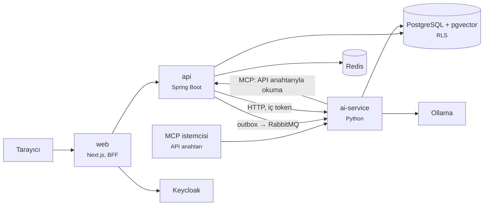

# Meridian

Çok kiracılı kurumsal bilgi ve ajan platformu. Kiracılar GitHub kaynaklarını indeksler, sorulara
kaynak gösteren akışlı cevaplar alır, onaylı adımlarla çalışan bir ajan ve MCP sunucusu kullanır.
Sürüm geçmişi ve ölçülen sonuçlar [CHANGELOG.md](CHANGELOG.md) içindedir.

## Bileşenler

| Dizin | Teknoloji | İş |
|---|---|---|
| [`apps/api`](apps/api) | Java 25, Spring Boot, Spring Modulith | Çekirdek API: kimlik, kiracılar, bilgi, sohbet, ajan, denetim, kota, API anahtarları ([modüller](docs/architecture/modules.md)) |
| [`apps/ai-service`](apps/ai-service/README.md) | Python 3.13, uv | İndeksleme, arama, kaynaklı cevap, ajan, MCP sunucusu, kod korumaları, değerlendirme |
| [`apps/web`](apps/web/README.md) | Next.js | Giriş (BFF), sohbet, ajan sayfası, yönetim paneli |
| [`packages/api-contract`](packages/api-contract/openapi.yaml) | OpenAPI | API sözleşmesi; sunucu arayüzleri ve web tipleri buradan üretilir |
| [`packages/eval`](packages/eval) | JSONL, rapor | Altın set, kırmızı takım seti, değerlendirme raporları ve eşikler |
| [`packages/load`](packages/load/README.md) | k6 | Yük testi senaryoları ve raporlar |
| [`infra/compose`](infra/compose) | Docker Compose | Yerel altyapı ve izleme |
| [`docs`](docs) | Markdown | [ADR'ler](docs/adr/README.md), [mimari](docs/architecture), [tehdit modeli](docs/architecture/threat-model.md), [runbook'lar](docs/runbooks) |



Temel kararlar: modüler monolit ve ayrı AI servisi ([ADR-0001](docs/adr/0001-modular-monolith-and-ai-service.md)),
paylaşımlı şema ve satır düzeyi güvenlikle kiracı izolasyonu ([ADR-0002](docs/adr/0002-tenant-isolation-rls.md)),
transactional outbox ([ADR-0004](docs/adr/0004-rabbitmq-outbox.md)), token'ların tarayıcıya verilmediği web oturumu
([ADR-0013](docs/adr/0013-web-session-bff.md)).

## Gereksinimler

- Docker (Compose v2)
- JDK 25
- [uv](https://docs.astral.sh/uv/) (Python sürümünü kendisi indirir)
- Node.js 22
- GNU Make ve Bash (Windows'ta Git Bash)
- Cevap üretmek için [Ollama](https://ollama.com) ve `ollama pull llama3.2:3b`

## Yerelde çalıştırma

```bash
cp .env.example .env
```

```bash
make up
```

```bash
cd apps/api && ./mvnw spring-boot:run
```

```bash
make ai-run
```

```bash
cd apps/web && cp .env.example .env.local && npm ci && npm run dev
```

Web arayüzü http://localhost:3000 adresindedir. Yerel kullanıcılar
[`infra/helm/meridian/files/keycloak/meridian-realm.json`](infra/helm/meridian/files/keycloak/meridian-realm.json) içindedir.
İlk indekslemede embedding modeli (~2,2 GB) indirilir ve CPU'da yavaş çalışır.

| Servis | Adres |
|---|---|
| Web | http://localhost:3000 |
| Çekirdek API | http://localhost:8080 |
| AI servisi | http://localhost:8090 |
| Keycloak | http://localhost:8180 |
| RabbitMQ yönetimi | http://localhost:15672 |
| Grafana | http://localhost:3001 |
| Prometheus | http://localhost:9090 |
| PostgreSQL | `localhost:5432` (`make psql`) |

Tüm portlar yalnızca `127.0.0.1` üzerinde açılır. İzleri, metrikleri ve logları toplayıcıya göndermek
için `.env` içinde `OTEL_EXPORT=true` yapın ([ADR-0017](docs/adr/0017-observability.md)).

## Testler ve kontroller

| Komut | İş |
|---|---|
| `make api-test` | API derlemesi, birim ve entegrasyon testleri, modül ve mimari kuralları (Docker gerekir) |
| `make ai-test` | Ruff ve pytest (entegrasyon testleri Docker gerekir) |
| `make web-test` | Lint, tip denetimi, Vitest, üretilen tiplerin güncelliği |
| `make web-e2e` | Playwright: sahte OIDC ve API ile üretim derlemesi |
| `make e2e-full` | Tam sistem: gerçek Keycloak, API, AI servisi, kuyruk ve veritabanı |
| `make smoke`, `make obs-check` | Altyapı duman testi, Prometheus kuralları ve alarm testleri |
| `make contract-lint`, `make eval-validate` | Sözleşme lint'i, altın set doğrulaması |
| `make eval-smoke` | Modelsiz değerlendirme hattı duman testi |
| `make eval`, `make eval-answers`, `make eval-redteam` | Gerçek modelle ölçüm (uzun sürer, [ADR-0010](docs/adr/0010-eval-gate-in-ci.md)) |
| `make load` | k6 yük testi ([ADR-0019](docs/adr/0019-load-test.md)) |

CI ([`.github/workflows/ci.yml`](.github/workflows/ci.yml)) bunların modelsiz olanlarını ve gitleaks taramasını çalıştırır.

## Durum

Henüz yok: dağıtım (Helm, Terraform, GitOps; [ADR-0009](docs/adr/README.md) planlandı), web ve dosya
yükleme kaynak çekicileri. Küçük yerel modelle cevap kalitesi canlı kullanım için yeterli değildir; ölçümler
[CHANGELOG.md](CHANGELOG.md) ve [`packages/eval/reports`](packages/eval/reports) içindedir.

Üçüncü taraf içerik: [NOTICE.md](NOTICE.md).
