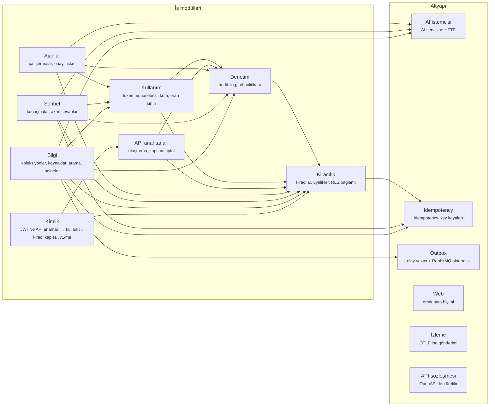

# Çekirdek API modülleri

Çekirdek API tek bir dağıtım birimidir (ADR-0001), ama içi modüllere ayrılmıştır. Her modülün
hangi modüllere bağımlı olabileceği `package-info.java` dosyasında yazılıdır ve
`ModularityTest` (Spring Modulith) bunu her derlemede denetler. İzinsiz bir bağımlılık ya da
döngü CI'ı kırar. Bu belge `package-info.java` dosyalarıyla aynı kalmalıdır; çelişkide doğru olan koddur.

Okunurluk için `contract` okları çizilmedi: `ai`, `idempotency`, `outbox`, `web` ve `observability`
dışındaki her modül `contract`'a bağımlıdır.

| Modül | İzin verilen bağımlılıklar | Neden |
|---|---|---|
| `identity` | `tenancy`, `apikeys`, `contract` | Kiracı kapısı üyeliği `tenancy`'den sorar; `X-API-Key` doğrulaması `apikeys`'ten |
| `tenancy` | `idempotency`, `contract` | Kiracı oluşturma idempotent'tir |
| `knowledge` | `ai`, `tenancy`, `audit`, `usage`, `idempotency`, `outbox`, `contract` | Rol denetimi ve denetim kaydı, arama için AI servisi ve oran sınırı, tekrarlanabilir oluşturma, indeksleme olayı |
| `chat` | `ai`, `tenancy`, `audit`, `usage`, `idempotency`, `contract` | Kiracı bağlamı, AI servisinden akan cevap, kota ve oran sınırı, tekrarlanabilir konuşma oluşturma |
| `agents` | `ai`, `audit`, `usage`, `tenancy`, `contract` | Ajan adımları AI servisinde çalışır; onay ve ticket denetime yazılır, token kotadan düşer (ADR-0015) |
| `apikeys` | `tenancy`, `audit`, `contract` | Anahtar, oluşturanın rolünü aşamaz; oluşturma ve iptal denetime yazılır (ADR-0014) |
| `usage` | `tenancy`, `audit`, `contract` | Kullanım raporu role göre açılır (ADR-0014) |
| `audit` | `tenancy`, `contract` | Rol kararı (`Policy`) üyelikten okunur; reddedilen kararlar da kaydedilir |
| `ai` | — | Altyapı parçası; AI servisinin iç uçlarını çağırır, iş modüllerini bilmez |
| `outbox` | — | Altyapı parçası; olayın içeriğini bilmez (ADR-0004) |
| `idempotency` | — | Altyapı parçası; iş modüllerini bilmez |
| `web` | — | Ortak HTTP davranışı; iş modüllerini bilmez |
| `observability` | — | Log gönderim yapılandırması (ADR-0017) |
| `contract` | — | Üretilen kod; açık modül (alt paketleri herkese görünür) |

## Modül sınırlarının ötesindeki kurallar (`ArchitectureRulesTest`)

1. **Her `@RestController` sözleşmeden üretilen bir arayüzü uygular.** Sözleşmede olmayan uç nokta yazılamaz.
2. **Ham JDBC bağlantısına yalnızca `TenantAwareTransactionManager` dokunur.** Bağlantıya doğrudan
   erişen kod kiracı bağlamını atlayabilir ya da `set_config` ile başka bir kiracıyı taklit edebilir.
3. **İstek bağlamı `ThreadLocal` ile taşınmaz.** `ScopedValue` blok bitince kendiliğinden temizlenir.

Her kural, bilerek ihlal edilerek denenmiştir (mutasyon denemesi): ihlal CI'da yakalanır.
